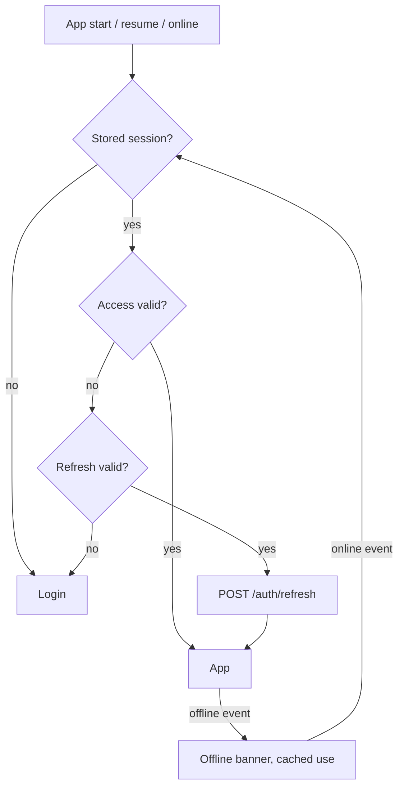

# Requirements

### Overview & Goals
Update `docs/feature-account-setup.md` (and cross-reference `docs/features.md`, `docs/spec.md`) so no app functionality is reachable without successful authentication, sessions persist across restarts, and offline use is graceful.

### Functional Requirements (new/changed)
- FR-A1 Auth gate: on first startup the app shows only login or registration. No other route or API call is usable until authenticated. Share links also require auth and are remembered through login.
- FR-A2 Access token lasts 1 hour. Refresh token lasts 2 weeks.
- FR-A3 Session persistence: on app load a stored session is restored. If the access token is valid, go straight to the app.
- FR-A4 If the access token has expired, silently refresh with the refresh token. If the refresh succeeds, continue and store the new tokens.
- FR-A5 If both tokens are expired or the refresh is rejected, clear the session and show login.
- FR-A6 Offline: a signed-in user who goes offline sees a persistent banner, 'Operating offline', and the app keeps working with cached data.
- FR-A7 Reconnect: when the connection returns, the app checks token expiry and acts as on a resume from pause. It refreshes if needed, shows login if both tokens have expired, and otherwise hides the banner.
- FR-A8 Sign-up and sign-in still need a connection. An offline user with no session sees the login screen with a connection-needed message. Sign-out works offline and clears the tokens.
- FR-A9 App resume from background applies the same expiry check as startup.

### Out of Scope
Social login, MFA, multi-device session management.

### Edge Cases
Refresh token rotation or reuse is rejected. The access token expires while offline, so the user keeps using cached data and is only challenged on reconnect. A 401 mid-session triggers one refresh attempt, then login. Concurrent requests share a single refresh call.

# Technical Design

### Current Implementation
The client keeps one token via `getToken`/`setToken` in `client/src/lib/api.ts` (localStorage). Routes are gated behind sign-in (step 1 is complete). The server has no refresh token or token-lifetime handling.

### Key Decisions
- The server issues a short-lived access token (1h) and an opaque refresh token (14d). The refresh token is stored hashed server-side and rotated on each use. Add `POST /auth/refresh` and revoke the refresh token on sign-out.
- The client stores both tokens plus their expiry times. Replace the single token in `api.ts`.
- A central `AuthProvider` or auth service owns the states `unauthenticated | authenticated | offline`. Route guards read it.
- `api.ts` adds a 401 interceptor with a single-flight refresh and one retry.
- Connectivity comes from `navigator.onLine` plus the `online`/`offline` events, confirmed by a failed network request. The `OfflineBanner` is an Ionic component shown at the app shell level.
- The startup and resume check happens in the app shell before the first route renders. It also runs on the `online` event and on the app resume event.

### Risks
Storing tokens in localStorage is exposed to XSS. Mitigate with secure storage on native builds. A refresh fails while offline, so defer the refresh until reconnect and don't log the user out.

# Testing

- Unauthenticated access to any route or API returns the login screen or a 401.
- Valid session restored on reload. Expired access token plus valid refresh gives a silent refresh. Both expired gives login.
- Offline shows the banner and cached data stay usable. On reconnect, the refresh or login prompt runs and the banner clears.
- Refresh rotation: reusing an old refresh token is rejected. Sign-out works offline.

# Delivery Steps

### ✓ Step 1: Update account-setup requirements and decisions
docs/feature-account-setup.md contains the new auth gate, token lifetime, persistence and offline requirements.

- Revise FR1, FR9, FR15, FR17 and FR18, and add FR-A1 to FR-A9.
- Add edge cases and decisions (1h access token, 2w refresh token, rotation, banner).
- Update the Constraints section to say that cached use continues offline for signed-in users.

### ✓ Step 2: Add implementation steps for sessions and offline mode
The Implementation Steps table has new steps with Covers, Details, Status and Tests.

- Step 8: server access and refresh tokens, `/auth/refresh`, revocation.
- Step 9: client token storage, startup restore, 401 refresh interceptor in `client/src/lib/api.ts`, route guards.
- Step 10: connectivity detection, offline banner, and reconnect and resume re-validation.
- Adjust Step 7 to reference the banner and Step 3 to cover the refresh-token revocation on sign-out.

### ✓ Step 3: Sync related docs
Other feature docs are consistent with the new auth rules.

- Update docs/features.md and docs/spec.md with the auth gate and session lifetime.
- Note in feature-sharing.md that links resume after login or refresh.